  

  <a href="https://codewtato.github.io/noty-descargas/"><b>🌐 Sitio web</b></a> &nbsp;·&nbsp;
  <a href="https://github.com/codewtato/noty-descargas/releases"><b>⬇️ Descargar</b></a> &nbsp;·&nbsp;
  <a href="#-preguntas-frecuentes"><b>❓ Preguntas</b></a>

---

## ✨ ¿Qué es Noty?

Notas, listas y pizarrones que podés **compartir en vivo con tus amigos**, y una **burbuja** para guardar al instante lo que encontrás en cualquier programa. Simple, rápida y gratis.

## 🫧 La burbuja (solo en Windows)

Una pelotita que vive al costado de tu pantalla. Estás viendo un reel, un artículo o una foto: lo arrastrás hasta ahí y **queda guardado**.

  

- **Arrastrás y soltás** un link, un texto o una imagen desde cualquier programa.
- **Copiar = guardar:** copiás un link de Instagram, TikTok o YouTube y te pregunta si lo guardás.
- **Capturas:** si sacaste una captura mientras no estabas en Noty, te ofrece guardarla.
- Después lo pasás a una nota cuando quieras.

## 🚀 Todo lo que hace

| | |
|---|---|
| 🤝 **En vivo con tus amigos** | Compartí una nota por su `@usuario` y mirá cómo escriben, letra por letra. Ves quién está en la nota. |
| 🎨 **Notas, listas y pizarrones** | Listas con casillas, imágenes, emojis y un pizarrón para dibujar con mouse, touch o lápiz. |
| 💬 **Chat y cartas** | Mensajes con emojis y notas adjuntas, y cartas con papel y animación. |
| ⏰ **Recordatorios** | Avisos que llegan aunque cierres la ventana. También en el celular. |
| 🎙️ **Che Noty** | Pedile por voz que cree una nota, abra otra o le mande un mensaje a un amigo. Siempre te pregunta antes de compartir. |
| 🔒 **Notas con PIN** | Cifrá las notas privadas con un PIN. Ni el servidor las puede leer. |
| 📴 **Sin internet** | Escribí sin conexión: se sube todo cuando vuelve. Sin cuenta, tus notas quedan solo en tu equipo. |
| ✦ **Noty Premium** | Temas animados, colores para tus notas, estilos de burbuja y el triple de pedidos a Noty IA. |

## ⬇️ Descargar

👉 **[Descargar la última versión](https://github.com/codewtato/noty-descargas/releases/latest)** (o usá el [sitio web](https://codewtato.github.io/noty-descargas/), que elige el archivo correcto para tu sistema).

| Sistema | Archivo |
|---|---|
| 🪟 **Windows 10 / 11** | `…x64-setup.exe` |
| 🤖 **Android** | [`Noty.apk`](https://github.com/codewtato/noty-descargas/releases/latest/download/Noty.apk) |
| 🐧 **Cualquier Linux** | `….AppImage` |
| 🎩 **Fedora / openSUSE** | `….rpm` |

### Cómo instalar

<b>🪟 Windows</b>

1. Abrí el `.exe` que descargaste.
2. Si aparece **"Windows protegió tu PC"**, tocá **Más información → Ejecutar de todas formas**. Es normal en apps nuevas que todavía no tienen firma paga.
3. Seguí el instalador. Noty queda en la bandeja y se actualiza solo.

<b>🤖 Android</b>

1. Descargá `Noty.apk` desde el celular y abrilo.
2. Android te va a pedir permiso para instalar apps de esta fuente: aceptalo.
3. Las próximas actualizaciones se bajan e instalan desde la misma app.

<b>🐧 Linux</b>

- **AppImage:** `chmod +x Noty*.AppImage` y abrilo con doble clic.
- **Fedora / openSUSE:** `sudo dnf install ./Noty-*.rpm`

## ❓ Preguntas frecuentes

<b>¿Necesito una cuenta?</b>

No. Sin cuenta tus notas quedan solo en tu equipo. Con cuenta se sincronizan entre tus dispositivos y las podés compartir con amigos. Podés entrar con correo, Google, Discord o GitHub.

<b>¿Es gratis?</b>

Sí. Existe Noty Premium, que es opcional: agrega temas animados, colores para tus notas, estilos de burbuja y más pedidos diarios a Noty IA.

<b>¿Por qué Windows me muestra una advertencia?</b>

Porque el instalador todavía no tiene una firma de código paga, y Windows desconfía de las apps con pocas descargas. No significa que tenga un virus. Con el tiempo y más descargas la advertencia deja de aparecer.

<b>¿Qué pasa con mis datos?</b>

Tus notas son tuyas. Las notas con PIN se cifran en tu dispositivo antes de subirse. Si algo no te cierra, escribinos desde la sección Ayuda de la app.

<b>Encontré un problema</b>

Contanoslo en [Issues](https://github.com/codewtato/noty-descargas/issues) o desde **Ayuda** dentro de la app.

---

Este repositorio solo contiene los instaladores; el código de Noty es privado.

